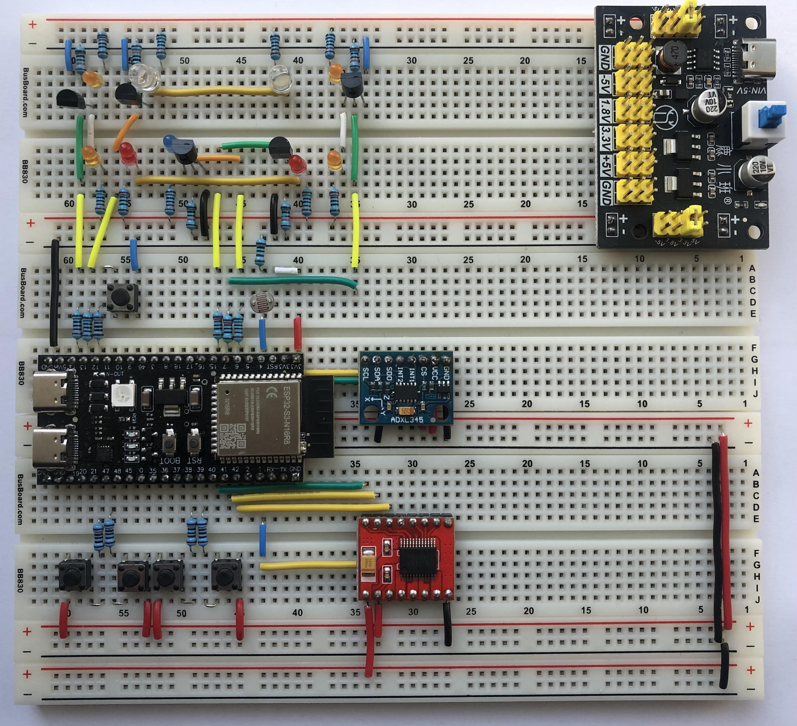

# ESP32-S3 Automotive Control System Simulator

A breadboard-based automotive electronics simulator implemented in **C++17** for the **ESP32-S3**, using the Arduino framework and PlatformIO.

The project demonstrates modular embedded software design, explicit dependency injection, hardware abstraction interfaces, non-blocking state machines, button gesture recognition, and PWM-driven lighting effects. It is an educational prototype, **not an automotive safety system**.

## Hardware Prototype



The prototype is built on a breadboard using an ESP32-S3,
LED indicators, push buttons, and an ambient light sensor.

## Features

- **Headlights:** cycle through `OFF → ON → AUTO → OFF` using the LIGHT button. AUTO mode uses a photoresistor with filtered readings and hysteresis to decide whether it is dark.
- **Brake lights:** illuminate while the BRAKE button is held, with configurable brightness transitions.
- **Emergency braking simulation:** after 2 seconds of holding BRAKE, both turn indicators flash rapidly for 3 seconds, then continue flashing at the regular hazard rate until BRAKE is released.
- **Turn indicators:** single click toggles left, double click toggles right, and long press toggles hazard lights on the TURN button.
- **Crash simulation:** a single click on CRASH activates the crash state, simulates airbag deployment, and stops the engine. A long press resets the crash state. During a crash, the headlights and both turn indicators flash; crash indication takes precedence over emergency-braking flashing.
- **Engine simulation:** the ENGINE button toggles engine state. Restart is blocked after a crash until the crash state is reset. The onboard addressable RGB LED shows green when the engine is running.
- **Airbag indication:** a separate PWM LED lights when airbags are marked as deployed.

Buttons are debounced in software; gesture recognition supports single, double, and long presses. Timing and PWM brightness transitions are driven by `millis()` rather than blocking animation delays.

## Hardware

- ESP32-S3 development board with an ESP32-S3-WROOM-1 **N16R8** module (16 MB flash, 8 MB PSRAM)
- Photoresistor / voltage-divider input
- Five pushbuttons
- External LEDs for headlights, brakes, left and right indicators, and airbag status
- Onboard addressable RGB LED (NeoPixel-compatible)
- Appropriate current-limiting resistors and LED drive circuitry

### GPIO assignments

These values are taken from `include/platform/Board.h` in the current source tree.

| Signal | GPIO | Notes |
| --- | ---: | --- |
| Photoresistor (LDR) | 4 | Analog input |
| ENGINE button | 12 | Active-low |
| LIGHT button | 21 | Active-high |
| BRAKE button | 38 | Active-high |
| TURN button | 47 | Active-high |
| CRASH button | 39 | Active-high |
| Headlights LED output | 13 | PWM channel 0 |
| Brake lights LED output | 15 | PWM channel 1 |
| Left turn LED output | 14 | PWM channel 2 |
| Right turn LED output | 7 | PWM channel 3 |
| Airbag LED output | 6 | PWM channel 4 |
| Engine RGB LED | 48 | Addressable RGB |

**Important:** Button polarity and wiring must match the source configuration. Confirm GPIO suitability and electrical connections for your specific ESP32-S3 board before powering the circuit.

## Controls

| Input | Gesture / action | Result |
| --- | --- | --- |
| LIGHT | Single click | Cycle OFF / ON / AUTO |
| BRAKE | Press and hold | Brake lights; emergency flashing after prolonged hold |
| TURN | Single click | Toggle left indicator |
| TURN | Double click | Toggle right indicator |
| TURN | Long press | Toggle hazard indicators |
| CRASH | Single click | Trigger simulated crash and airbag deployment |
| CRASH | Long press | Reset simulated crash |
| ENGINE | Single click | Toggle engine OFF / RUNNING (unless crash-locked) |

Default button timings: **30 ms** debounce, **300 ms** double-click interval, **800 ms** long-press threshold. These are configured in `include/platform/Board.h`.

## Software architecture

The firmware separates vehicle state, application logic, input processing, output behavior, and hardware-specific drivers.

```text
include/                         Public declarations and interfaces
  app/                           CarController, AmbientLightController
  bootstrap/                     ApplicationBootstrap (composition root)
  config/                        Lighting, ambient light, car timing
  domain/                        VehicleState and domain enums
  drivers/                       ESP32/Arduino hardware implementations
  indication/                    StatusIndicatorController
  input/                         Button input, debouncing, gestures, interfaces
  lighting/                      LightingController, BrightnessAnimator
  output/                        LED output interfaces
  platform/                      Board GPIO mapping
src/                             Implementations and main.cpp
test/                            PlatformIO test directory (no project tests yet)
platformio.ini                   Build configuration
```

`ApplicationBootstrap` constructs and connects the hardware drivers and controllers. `ButtonInputManager` updates the inputs; `CarController` translates input events into a `domain::VehicleState`; `LightingController` renders the lighting behavior; and `StatusIndicatorController` updates engine and airbag indicators. The ambient light controller supplies the filtered light/dark state.

Hardware-facing dependencies are expressed through interfaces such as `IButton`, `IButtonInput`, `ILightSensor`, `IPwmLed`, and `IRgbLed`, allowing application logic to be tested with substitutes for real peripherals.

The application currently runs in the Arduino `setup()` / `loop()` model. The main loop calls `application.update(millis())` and then `delay(5)`; there are no dedicated application FreeRTOS tasks in this version.

## Build and upload

Install [Visual Studio Code](https://code.visualstudio.com/) with the [PlatformIO IDE](https://platformio.org/install/ide?install=vscode) extension, connect the ESP32-S3 board, and open this repository as a PlatformIO project.

From a terminal with the PlatformIO CLI available:

```bash
pio run -e esp32-s3-n16r8
pio run -e esp32-s3-n16r8 -t upload
pio device monitor -b 115200
```

The configuration in `platformio.ini` uses:

- Platform: `espressif32`
- Board: `esp32-s3-devkitc-1`
- Framework: `arduino`
- Language standard: GNU C++17
- Library: `adafruit/Adafruit NeoPixel`
- Serial monitor: 115200 baud
- Flash: 16 MB; PSRAM: OPI

## Configuration

- `include/platform/Board.h`: pin assignments and button gesture timing
- `include/config/AmbientLightConfig.h`: sampling interval, filtering, and light/dark thresholds
- `include/config/LightingConfig.h`: blinking intervals and LED fade durations
- `include/config/CarConfig.h`: emergency braking timings

The photoresistor ADC thresholds may require calibration for your circuit and lighting conditions.

## Testing and planned work

**Automated unit tests have not yet been added.** The `test/` directory currently contains the standard PlatformIO placeholder. The architecture is intended to support host-based unit tests of the debouncer, gesture recognizer, brightness animator, and vehicle-control logic.

Potential future improvements include:

- Host-based C++ unit tests and CI
- ADXL345 accelerometer integration for sensor-based crash detection (currently simulated by a button)
- Additional diagnostics and hardware-in-the-loop tests
- Expanded documentation of circuit wiring and electrical characteristics

Daytime running lights are not part of the current implementation.

## Disclaimer

This project is a learning and demonstration platform. Its simulated braking, crash, airbag, and engine behavior must **not** be connected to or relied upon for controlling a real vehicle or safety-critical hardware.
